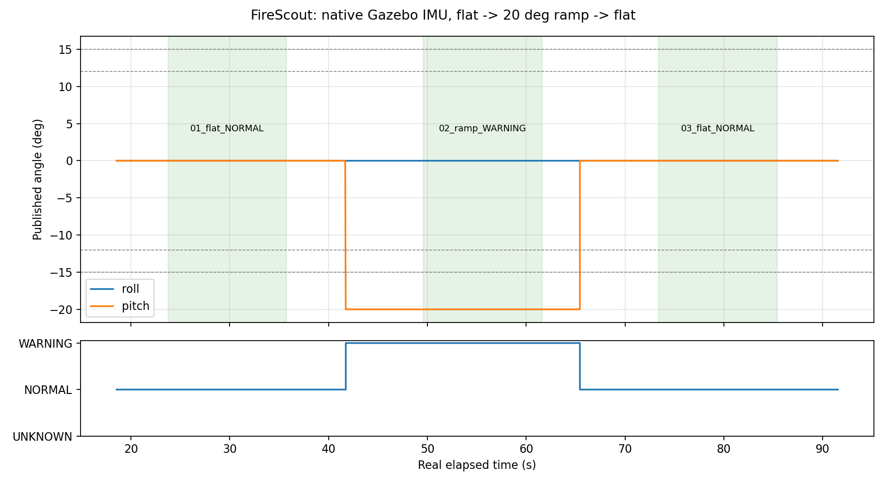

# FireScout IMU — fiziksel simülasyon testi, 7 Kasım 2026

**Sonuç: NORMAL → WARNING → NORMAL doğrulandı.**

Bu kayıt açık `industrial_world` oturumundaki gerçek `firescout_fs01` modelinden
alındı. Geçici 20° platform eklendi, robot üzerine yerleştirildi ve temas fiziği
ile yerleşmesi beklendi. `/imu/data` tek yayıncısı `ros_gz_bridge` idi;
yapay IMU mesajı ve `/cmd_vel` yayımlanmadı. Robot rampaya sürülmedi.

Her aşamada 8 saniye yerleşme bekleme süresinden sonra 12 saniyelik ölçüm yapıldı:

| Aşama | Yayımlanan pitch | Roll | Durum mesajları | Ham IMU mesajı |
|---|---:|---:|---:|---:|
| Düz zemin | ≈0° | ≈0° | 120 × NORMAL | 198 |
| 20° platform | −20.000002° | ≈0° | 120 × WARNING | 158 |
| Tekrar düz zemin | ≈0° | ≈0° | 120 × NORMAL | 188 |

Her pencerede roll ve pitch kanallarında ayrı ayrı 120 mesaj kaydedildi.
Gazebo'nun platformdaki gerçek model pozu yaklaşık `(1.69975, -1.8, 0.503116)` m,
pitch değeri `−0.349066` rad idi. Bu, IMU'daki yaklaşık −20° ile uyumludur.
Ham quaternion'lardan pitch ayrıca çevrilerek yayımlanan sonuçla karşılaştırıldı.

Grafik gerçek kayıttan üretildi; rqt_plot/Gazebo ekran görüntüsü değildir.
Yeşil alanlar ölçüm pencereleri, kesikli çizgiler ±12°/±15° demo eşikleridir.
Aradaki bekleme/yerleştirme verileri de grafikte korunmuştur.

## Kanıt dosyaları

- `summary.json`: sayısal aralıklar, mesaj sayıları ve üç aşamada `passed: true`.
- `samples.jsonl`: ham IMU alanları ve gerçek roll/pitch/durum çıktıları.
- `bag/`: `/imu/data`, iki açı, durum ve `/clock` için MCAP kaydı.
- `bag_validation.txt`: MCAP sonuna kadar okundu; toplam 24.795 mesaj.
  Ham IMU 1.075; roll/pitch/durum kanallarının her biri 739 mesaj içeriyor.
- `imu_source.txt`: bridge yayıncı bilgisi. CLI metin çıktılarının yalnızca
  sondaki fazla boş satırları temizlendi; MCAP, JSONL ve PNG içerikleri korunmuştur.
- `initial_model_pose.txt`, `01_*_model_pose.txt`, `02_*_model_pose.txt`,
  `03_*_model_pose.txt`: Gazebo'nun bildirdiği gerçek model pozları.
- `commands.jsonl`: model oluşturma/yerleştirme/kaldırma istekleri ve yanıtları.
- `imu_monitor.log`: ölçümler ve durum değişimleri; `bag_record.log`: recorder günlüğü.

## Doğrulanan manuel ekran görüntüleri

İlk otomatik koşudan sonra, **aynı açık Gazebo oturumunda ayrı bir ekran görüntüsü
tekrarı** yapıldı. Robot 20° platforma yeniden yerleştirildi; gerçek bridge verisinde
pitch≈−20° ve WARNING doğrulanarak kullanıcı görüntüyü alana kadar beklendi.
IMU terminali ve rqt_plot açık tutuldu; rqt_plot'un açı kanallarına abone olduğu
doğrulandı. Sonra robot düz zemine alındı; taze IMU'da |roll|<1°, |pitch|<1° ve
NORMAL durumu en az üç saniye boyunca doğrulanarak ikinci görüntü beklendi.

Kullanıcının `/home/bartu/Pictures/Screenshots/` altında kaydettiği üç PNG açılarak
incelendi ve içerikleri değiştirilmeden aşağıdaki adlarla kopyalandı:

| Görüntü | Gösterdiği kanıt |
|---|---|
| [Eğik robot ve WARNING](screenshots/02_ramp_WARNING_gazebo_terminal.png) | Gazebo'da platform üstünde robot, terminalde ACTIVE / WARNING / VALID |
| [Eğimli rqt_plot](screenshots/02_ramp_WARNING_rqt_plot.png) | Gerçek roll/pitch topic'leri; roll≈0°, pitch≈−20° |
| [Düz robot ve NORMAL](screenshots/03_flat_NORMAL_gazebo_terminal.png) | Gazebo'da düz zeminde robot, terminalde ACTIVE / NORMAL / VALID |

Kaynak adlar, boyutlar ve SHA256 değerleri [görüntü dizininde](screenshots/README.md)
kayıtlıdır. Terminal görüntülerinde sağ kenardaki uzun ölçüm satırları kısmen
kesiliyor; sayısal açılar ayrı grafik, canlı doğrulama ve ham kayıtla desteklenir.
Manuel görüntüler ilk 12 saniyelik bag pencereleriyle eşzamanlı çekilmiş değildir.

İlk koşudaki Gazebo screenshot servisi `true` cevabına rağmen PNG üretmemişti;
`*_screenshot_reply.txt` yalnızca bu başarısız denemeyi belgeler. Yukarıdaki PNG'ler
kullanıcının sonraki gerçek masaüstü çekimleridir.

## Korunanlar ve testin sınırı

Normal workspace `~/firescout_ws` kullanıldı. IMU uygulaması, launch/world ve
mevcut RViz ayarları değiştirilmedi. RViz dosyası başlangıç yedeğiyle bayt bayt
karşılaştırıldı; SHA256 `de3c632b88b951a663f1a3f1d73ece9bd042514415cbc3658f59918e893db3b8`.
İlk otomatik koşu sonunda platform kaldırıldı. Manuel ekran görüntüsü tekrarında
yeniden oluşturuldu; son durumda robot düz başlangıç yerinde, platform dünyada,
IMU terminali ve grafik açıktır. Bu dokümantasyon/commit adımında simülasyona
müdahale edilmedi. Önceden açık Gazebo/RViz ve diğer ekip modelleri korundu.

Bu test fiziksel simülasyon eğim doğrulamasıdır; gerçek donanım, rampaya sürüş,
fiziksel devrilme sınırı veya sürekli açı taraması testi değildir. Eğim ölçütü
`max(abs(roll), abs(pitch))`; toplam fiziksel yatıklık açısı değildir.
12°/15° histerezis sınırlarının tam değer ve ara bölge testleri mevcut otomatik
testlerde doğrulandı; fiziksel koşu 0°/20°/0° noktalarını kapsar.
21 otomatik test bu çalışma sırasında yeniden çalıştırıldı ve geçti.

## Dosya boyutu ve inceleme durumu

MCAP yaklaşık 1.8 MB, aşama etiketleriyle okunabilir JSONL yaklaşık 1.0 MB'tır.
Tek MCAP asıl ROS kaydıdır; JSONL aşama bazında inceleme/özet ve grafiği destekler.
`*_submission.zip` aynı kanıtları çoğalttığından yerelde bırakılır, Git'e eklenmez.
Önceden hazırlanmış ZIP manuel görüntülerden eskidir; güncel kanıt kaynağı bu dizindir.

Fiziksel eğim testi ve manuel görüntüler tamamlandı. Main'e merge için ekip
incelemesi ve ortak entegrasyon testi beklenir. Tekrarlama adımları:
[test rehberi](../../docs/IMU_PHYSICAL_TEST.md).
